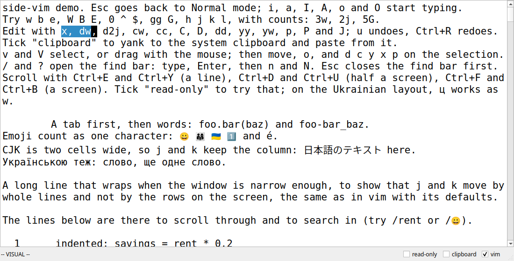

# side-vim

[](https://pypi.org/project/side-vim/)
[](#install)
[](LICENSE)

[](https://codecov.io/gh/sprytnyk/side-vim)


A Vim mode for PySide6's `QPlainTextEdit`. Attach it to an existing editor to add
Normal, Insert, Visual and Visual Line modes.



## Install

Requires Python 3.12 or newer and PySide6 6.8 or newer. Installing side-vim also
installs PySide6-Essentials.

```sh
uv add side-vim
```

## Usage

```python
import sys

from PySide6.QtWidgets import QApplication, QLabel, QPlainTextEdit, QVBoxLayout, QWidget

from side_vim import VimMode

app = QApplication(sys.argv)
window = QWidget()
editor = QPlainTextEdit("Try w, i, Esc, v and y.")
status = QLabel()
layout = QVBoxLayout(window)
layout.addWidget(editor)
layout.addWidget(status)

vim = VimMode(editor)  # Starts in Normal mode. Qt deletes it with the editor.
status.setText(vim.mode.value)
vim.mode_changed.connect(lambda mode: status.setText(mode.value))

window.resize(800, 500)
window.show()
editor.setFocus()
sys.exit(app.exec())
```

Attach one `VimMode` per editor. Import `Mode` to compare `vim.mode` with
`Mode.NORMAL`, `Mode.INSERT`, `Mode.VISUAL` or `Mode.VISUAL_LINE`.

| API | Behavior |
| --- | --- |
| `vim.mode_changed.connect(callback)` | Calls `callback(mode)` when the mode changes. |
| `vim.pending_changed.connect(callback)` | Calls `callback(text)` with pending keys such as `2d`, or `""` when done. Moving the focus to another widget drops pending keys, as a click in another window does in Vim. Switching apps or opening a menu keeps them. |
| `vim.escape_hook = callback` | Calls `callback()` before handling Esc. Return `True` if the app used it, for example to close a popup. |
| `vim.search_hook = callback` | `/` calls `callback(True)`; `?` calls `callback(False)`. The app opens its search UI. |
| `vim.window_hook = callback` | `Ctrl+W` and one more key call `callback(key)`, such as `"h"` for `Ctrl+W h`. The app moves the focus, for example to a panel beside the editor. |
| `vim.spell_hook = callback` | The spelling commands call `callback(command, count)`, such as `("z=", None)` or `("]s", 2)`. The app shows suggestions, moves the cursor or adds the word. |
| `vim.set_search("rent", forward=True)` | Saves the search text and jumps to the next match. `n` repeats in that direction; `N` reverses it. |
| `vim.normal()` | Goes to Normal mode as Esc does, from Insert or Visual mode. |
| `vim.clipboard = True` | Uses the system clipboard for yank, delete, change and paste. Defaults to `False`. |
| `vim.layout_map = UKRAINIAN` | Maps Ukrainian letters to Vim keys. This is the default; import `UKRAINIAN` from `side_vim`. Set `None` to disable it, or pass your own dictionary. |
| `vim.set_enabled(False)` | Restores the plain editor and its cursor. `True` enables Vim in Normal mode. Read the setting through `vim.enabled`. |
| `vim.detach()` | Removes Vim from the editor. To turn it off for a while, use `set_enabled(False)`. |

When the app accepts a search, call `set_search` with its text and direction,
after `normal()` if the search was opened from Insert mode.
Search is case-sensitive, wraps around the document, and uses plain text rather
than regular expressions. Each editor keeps its own search. An empty string
clears it. In Insert mode or while disabled, `set_search` saves the search without
moving the cursor. The [demo](https://github.com/sprytnyk/side-vim/blob/main/side_vim/__main__.py)
shows a find bar and an Esc hook together.

The unnamed register is shared between editors in the same process. With
`clipboard=False`, yank in one editor and paste in another. With `clipboard=True`,
text copied in another app pastes as whole lines if it ends in a newline.

## Supported keys

Counts work with motions and edits: `3w`, `5G`, `2dd`, `y3j`. A counted insert
repeats the typed text: `3ix<Esc>` inserts `xxx`.

| Action | Keys |
| --- | --- |
| Move | `h j k l`, `w b e`, `W B E`, `0 ^ $`, `gg G` |
| Insert | `i a I A o O` |
| Delete, change, yank | `d c y` followed by a motion; `dd cc yy`, `x D C` |
| Paste, join | `p P`, `J` |
| Replace characters | `r` and a character: `3rx` turns three characters into `xxx` |
| Switch case | `~`: `3~` turns `abc` into `ABC` and moves past it |
| Undo, redo | `u`, `Ctrl+R` |
| Select | `v` for characters, `V` for lines; motions extend the selection |
| Edit a selection | `d c y x p r ~`; `o` switches its ends |
| Search | `/ ?` through the app hook, then `n N` |
| Scroll a line | `Ctrl+E`, `Ctrl+Y` |
| Scroll half a screen | `Ctrl+D`, `Ctrl+U` |
| Scroll a screen | `Ctrl+F`, `Ctrl+B` |
| Return to Normal | `Esc`, `Ctrl+[` |
| Window command | `Ctrl+W` and a key, through the app hook |
| Spelling | `z=`, `]s [s`, `zg zG`, through the app hook |

In Normal and Visual modes, the Ctrl keys above take priority over app shortcuts.
`j` and `k` keep the screen column across tabs and wide characters, and a wrapped
line counts as one line, as in Vim.

After `r`, Enter puts in a line break, and `Ctrl+E` or `Ctrl+Y` copy the
characters below or above. `Ctrl+V` puts in the next key as it is, or a character
code such as `065` or `u20ac`. `Ctrl+K` and two characters put in a
[digraph](https://vimhelp.org/digraph.txt.html), such as `e:` for ë. Esc cancels
`r`. These work as in Vim.

This release has only the keys above. It has no repeat (`.`), text objects,
`f t`, `g~ gu gU`, colon commands, macros, marks, named registers or block
selection.

## Differences from Vim

side-vim follows Vim 9.1 with its default settings, except for these:

- Joined emoji and flags, such as 👨‍👩‍👧 and 🇺🇦, are one character. Vim splits
  them into their parts. Accents, CJK and single emoji work as in Vim, except
  that `r Ctrl+E` and `r Ctrl+Y` copy an accented letter made of two code points
  whole. Vim copies it without the accent.
- Qt turns a carriage return into a line break, so `r` can't put one in. Vim
  puts one in for `r Ctrl+V Enter`, and for Enter after `r` in Visual mode.
  side-vim does nothing there, and Visual mode keeps its selection.
- After `r Ctrl+V` and part of a code, such as `r Ctrl+V 6`, a key with no
  character, such as an arrow, ends the code. Vim then also runs that key as a
  command, but side-vim drops it.
- Search uses plain text, not regular expressions. There is no command line.
  `/` and `?` call `search_hook`, then the app shows its own search box and
  passes the text to `set_search`.
- side-vim has no windows. `Ctrl+W` and the key after it go to `window_hook`,
  and the app decides what they do. `Ctrl+W Ctrl+H` and `Ctrl+W Left` arrive as
  `h`, as in Vim. It works only in Normal mode, and the hook gets no count.
- side-vim has no spell checker. `z=`, `]s`, `[s`, `zg` and `zG` go to
  `spell_hook` with their count, and the app finds the words and shows the
  suggestions. They work only in Normal mode. `]s` and `[s` aren't motions, so
  `d]s` does nothing. side-vim doesn't have `zw`, `zW` or `zug`.
- `J` puts one space after a period, like Vim with `nojoinspaces`. Vim's default
  puts two.
- Qt stops scrolling when the last line reaches the bottom of the editor. Vim
  scrolls on until the last line is at the top, so `Ctrl+F` and `Ctrl+E` stop
  sooner near the end. The cursor still goes to the line Vim picks.
- In Insert mode, Esc and `Ctrl+[` go back to Normal mode. Every other key goes
  to the editor, so arrows, Backspace and app shortcuts work as in any Qt
  editor. side-vim doesn't have Vim's Insert mode keys, such as `Ctrl+W`,
  `Ctrl+U` and `Ctrl+O`.
- In Normal and Visual modes, Ctrl keys that side-vim doesn't use go to the
  editor or the app, and so do PageUp, PageDown and the function keys. `Ctrl+A`
  selects all, for example. Qt's keys that change the text do nothing in these
  modes: paste, cut, `Ctrl+Backspace` and `Ctrl+Delete`. In Vim, `Ctrl+V` starts
  a block selection, which side-vim doesn't have.
- In Normal and Visual modes, Alt keys go to the app's shortcuts first, so
  `Alt+H` can open a Help menu. gvim does the same with `winaltkeys=menu`.
  side-vim has no Alt keys of its own, so an Alt key that no shortcut uses does
  nothing. After `r` and `Ctrl+W`, the next key is side-vim's, even with Alt.
- Other keys without a command do nothing in Normal mode. They never type text.
- In Normal mode, an Esc with nothing pending goes to the app, so it can close a
  dialog, for example. Vim does nothing with that Esc except ring its error bell.
- A read-only editor allows movement, scrolling, selection, yank and search, and
  ignores edits. Vim only warns when you change a read-only file.
- Dragging with the mouse in Normal mode starts Visual mode.
- Outside Insert mode, Ukrainian letters work as the Latin keys in the same
  place, so `ц` is `w`. Vim needs `langmap` for that. Punctuation stays as typed,
  `ґ` isn't mapped because its key moves between layout variants, and `/` needs
  the English layout. The character after `r` is text, so `кц` puts in ц, as
  `langmap` does in Vim.
- On macOS, Ctrl means the physical Control key. Command shortcuts stay with the
  app.
- The tab width comes from the editor's tab stop, not from a `tabstop` setting.
- `u` and the app's undo share the editor's undo stack, so they undo the same
  steps.

## Develop

```sh
uv sync --locked
make run       # Demo window
make check     # Ruff and pytest
make format    # Format Python
make record    # Record expected results using local Vim
make unicode   # Regenerate Vim character classes and widths
make digraphs  # Regenerate Vim digraphs
make mac-keys  # Key checks on a Mac
```

Tests run Qt offscreen. CI runs for release tags and can also be started from
**Actions → CI → Run workflow**. It tests Linux, macOS and Windows on Python 3.12
and 3.14, and the lowest allowed PySide6 on Python 3.12.
The tests replay saved [Vim cases](https://github.com/sprytnyk/side-vim/tree/main/tests/cases),
so CI doesn't need Vim. Recording them needs Vim, and the scrolling cases need a
Unix terminal.

On each push to `main`, GitHub Actions runs the Linux test suite and updates the
coverage badge. The test log lists the 15 slowest setup, test or cleanup steps.

On a Mac, `make mac-keys` opens the demo and presses keys through macOS. It checks
Ctrl and Cmd keys, search, read-only mode and the Ukrainian layout, and prints PASS
or FAIL for each. Start it on the English (ABC) layout with Ukrainian-PC installed,
and don't type until it finishes.

## Release

Set these up by hand before the first tag:

1. In the GitHub repository, open **Settings**, then **Environments**, and create
   `pypi`. Add yourself as a required reviewer. Leave **Prevent self-review** off,
   so you can approve runs you start. Limit deployment tags to `v*`.
2. In your PyPI account's **Publishing** page, add a pending trusted publisher:

   | Field | Value |
   | --- | --- |
   | PyPI project | `side-vim` |
   | GitHub owner | `sprytnyk` |
   | Repository | `side-vim` |
   | Workflow | `release.yml` |
   | Environment | `pypi` |

   A pending publisher creates the project on its first upload. No PyPI token
   goes into GitHub. See the [PyPI setup guide](https://docs.pypi.org/trusted-publishers/creating-a-project-through-oidc/)
   and [GitHub approval guide](https://docs.github.com/en/actions/how-tos/deploy/configure-and-manage-deployments/review-deployments).

The project [release skill](https://github.com/sprytnyk/side-vim/blob/main/.claude/skills/release/SKILL.md)
has the command sequence and approval points.
